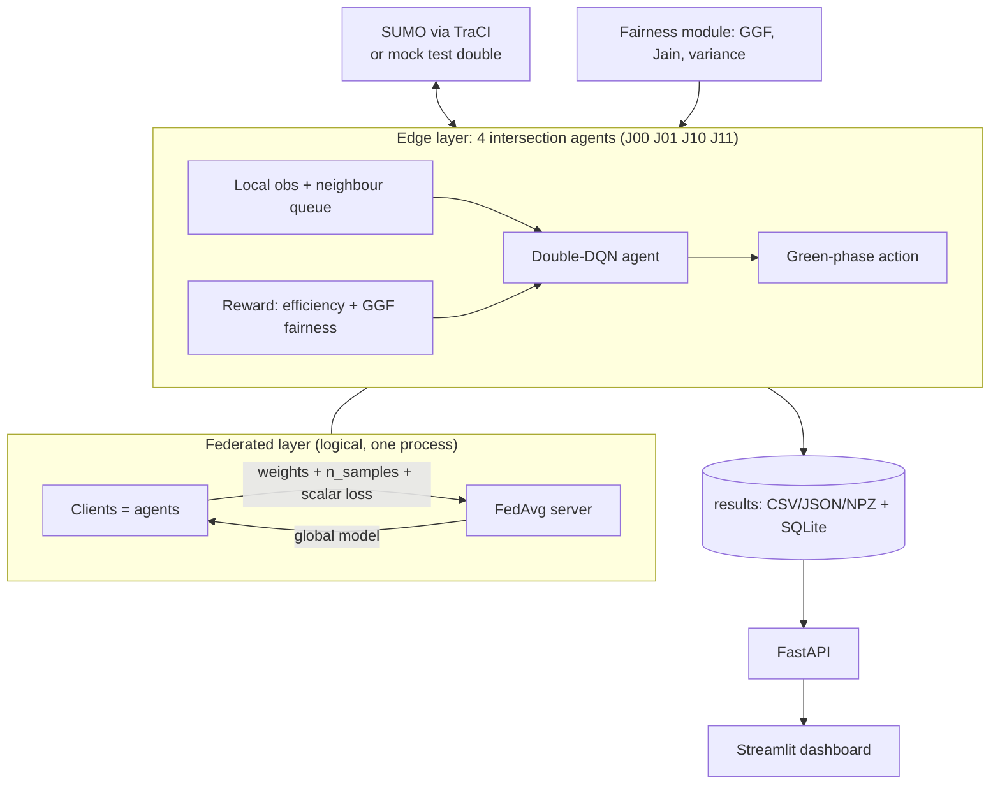

# Architecture

Title: **Fair Traffic Signal Control via Multi-Agent Reinforcement Learning** — *AI-Driven Fair & Adaptive Urban Traffic Management System* (from the review deck).

## Components → source requirement
| Source requirement (doc / slides) | Component | Test |
|---|---|---|
| Each intersection is an agent observing local state, choosing signal timing | `simulation/environment.py`, `agents/marl_agent.py` | `tests/unit/test_environment.py`, `test_model_agent_ckpt.py` |
| Multi-agent RL | independent Double-DQN agents, `agents/trainer.py` | `tests/integration/test_pipeline_mock.py` |
| Fairness-aware reward, Generalized Gini (GGF) | `fairness/generalized_gini.py`, `fairness/reward.py` | `test_fairness.py`, `test_reward.py` |
| Jain's index, waiting-time variance | `fairness/jain_index.py`, `waiting_time_variance.py`, `simulation/metrics.py` | `test_fairness.py`, `test_metrics.py` |
| Federated learning: share model updates, not raw data | `federated/` | `test_federated.py` |
| SUMO simulation, 4 intersections, scenarios | `simulation/sumo_backend.py`, `network/`, `scenarios/` | `test_topology_demand.py`, `test_sumo_backend.py` (needs SUMO) |
| Metrics: waiting time, throughput, fairness, queue, fuel | `simulation/metrics.py` | `test_metrics.py` |
| Compare fixed-time / RL / fair MARL / fair MARL+FL | `experiments/run_suite.py`, `compare_results.py` | pipeline test |
| Dashboard + API | `app/` | `test_app_services.py`, `test_api.py` (needs FastAPI) |

## Where the deck and the code differ (stated honestly)
* The deck's architecture picture shows **encrypted** model updates, pedestrians, cyclists, alerts and external systems. **Not implemented:** no encryption (clients and server are in one process), no pedestrians/cyclists, no alerts or external feeds. Dynamically weighted fairness is implemented only as an optional congestion-based extension (`reward.dynamic_fairness`, off by default).
* The research document mentions QMIX/MADDPG as examples; this implementation uses independent Double-DQN (see ALGORITHMS.md).
* The deck's workflow says "each intersection learns independently, then securely aggregates"; the code does learn independently and aggregates with FedAvg, but "securely" is **not** implemented.
